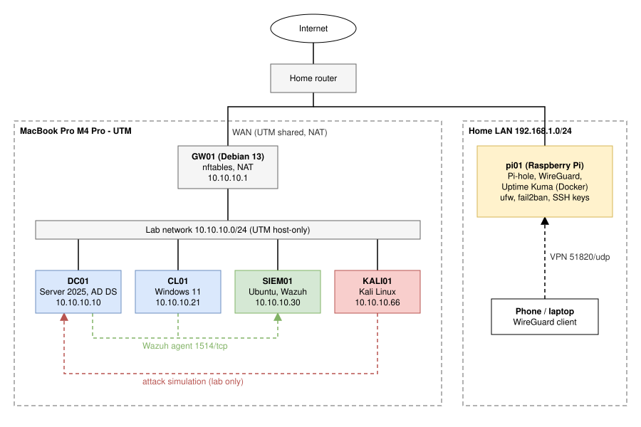
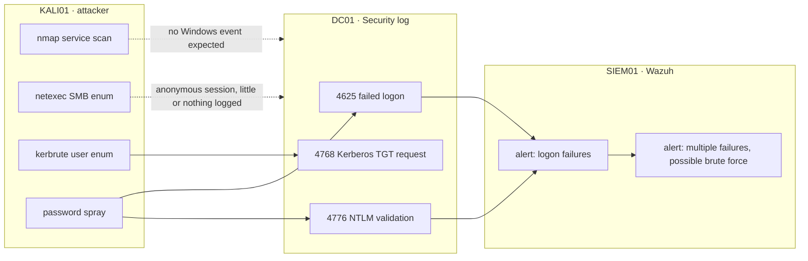

# Enterprise security homelab

A small but complete company network that I design, harden, attack and monitor myself, run on one
MacBook (UTM) and one Raspberry Pi. I treat it as a consulting engagement for a fictional client, so
every technical choice is tied to a business problem and written down the way a client deliverable would be.

> **Status (November 2026):** design, configs and scripts are done and in this repo. I am building the
> lab now. The [test plan](docs/test-plan.md) and the [evidence](evidence/) folder fill up as each part
> is verified; the "Measured" columns stay empty until I have run each check myself.

## The client

**Scheldt Logistics NV** is a made-up logistics company in Antwerp with 60 employees. It falls under
NIS2. Today it runs on local accounts with one shared admin password, everyone is local admin, and
nothing is logged. Their NIS2 self-assessment flagged identity management and logging as the biggest gaps.

My brief as junior consultant: give them central identity, a hardened baseline, security logging with
alerting, and prove that the detection works by attacking the network myself.

## Architecture



| Host | Platform | Role | IP |
|---|---|---|---|
| **GW01** | Debian 13 ARM64 | Router and firewall: nftables default-drop, NAT for the lab | 10.10.10.1 |
| **DC01** | Windows Server 2025 ARM64 | Active Directory, DNS, Group Policy, Windows LAPS | 10.10.10.10 |
| **CL01** | Windows 11 ARM64 | Domain-joined workstation, RSAT admin tools | 10.10.10.21 |
| **SIEM01** | Ubuntu Server 24.04 ARM64 | Wazuh manager, indexer and dashboard | 10.10.10.30 |
| **KALI01** | Kali Linux ARM64 | Attack simulation, in scope for this lab only | 10.10.10.66 |
| **pi01** | Raspberry Pi OS Lite 64-bit | Pi-hole DNS, WireGuard VPN, Uptime Kuma in Docker | home LAN |

More detail: [architecture and IP plan](docs/architecture.md).

## What the lab covers

| Area | What I do | Where |
|---|---|---|
| **Identity** | Company OU structure, 4 departments, 60 users provisioned by script, admin accounts split into tiers | [AD design](docs/ad-design.md) |
| **Hardening** | 14-character password policy with sane lockout, Windows LAPS, Protected Users, Tier 0 logon restrictions, LLMNR off, Print Spooler off on the DC, advanced audit policy | [Hardening](docs/hardening.md) |
| **Network** | Isolated lab subnet behind a Debian router with a default-drop nftables policy | [GW01 configs](P1-active-directory/configs/gw01/) |
| **Detection** | Wazuh agents on DC01 and CL01, Windows Security events into the SIEM | [siem01](siem01/), [windows-agents](windows-agents/) |
| **Offence** | Port scan, SMB and Kerberos enumeration and a password spray from Kali, then finding it in Wazuh | [Attack and detection](docs/attack-and-detection.md) |
| **Edge** | Raspberry Pi with ufw, fail2ban, key-only SSH and automatic updates, running DNS filtering, VPN and uptime monitoring | [pi](pi/) |

## Attack and detection, in one picture



The dotted lines are a finding in themselves: scanning and SMB enumeration leave little or no trace in the
Windows Security log, so the SIEM only sees the attack once credentials are tried. Catching the earlier
steps needs network-level detection, which is on the [roadmap](#roadmap). Expected events are listed in
[attack and detection](docs/attack-and-detection.md); what Wazuh really showed goes next to them after the run.

## Expected results

These are the **targets** each part of the lab must hit, written before the build so I test against
something concrete. The "Measured" column stays empty until I have run the check myself.

| Check | Target | Measured |
|---|---|---|
| Lab reaches the internet through GW01 only | `TcpTestSucceeded : True` from CL01; nothing reachable from the WAN side | |
| Domain DNS and DC SRV record resolve | `10.10.10.10` and `dc01.ad.scheldt.lab` | |
| 60 users in department OUs | `60` | |
| LAPS password stored in AD for CL01 | password and expiry returned | |
| Tier 0 admin cannot log on to CL01 | logon refused | |
| `10-Test-Lab.ps1` | 8 of 8 PASS | |
| Wazuh agents | DC01 and CL01 `active` | |
| Password spray shows up in Wazuh | rule 60122 per failed logon, rule 60204 for the burst, on agent DC01 | |
| PingCastle global risk score | lower after hardening than before; aim for 30 or below | before: / after: |

Full list with commands: [docs/test-plan.md](docs/test-plan.md).

## Screenshots

Screenshots of the running lab go here once it is built. The list of what I capture, and how I redact
it, is in [evidence/README.md](evidence/README.md).

<!--
After the build, replace this comment with the real images, for example:

| Wazuh: password spray detected | Kali: the spray that caused it |
|---|---|
|  |  |

| AD OU structure | PingCastle before and after |
|---|---|
|  |  |
-->

## Security decisions

A few choices that a reviewer would question, and why I made them.

- **No forced password expiry, 14-character minimum, lockout after 10 attempts.** Current NIST and
  Microsoft guidance: forced rotation pushes people to predictable passwords. A threshold of 10 still
  stops online guessing without letting an attacker lock out the whole company on purpose.
- **Domain admins can only log on to the domain controller.** If a domain admin signs in on an infected
  laptop, their credentials can be dumped and reused. A deny-logon GPO on workstations removes that path.
- **Windows LAPS instead of one shared local admin password.** With one shared password, one compromised
  PC means every PC is compromised.
- **Default-drop firewall on GW01.** The lab only gets out through NAT; nothing from outside reaches in.
- **Lab only:** Windows Server on ARM is an Insider build that Microsoft does not support in production.
  I use it because it runs natively on Apple Silicon. A real client would get x64 hardware or Azure.

## Repository layout

```text
.
├── docs/                       architecture, AD design, hardening, attack and detection, test plan
├── P1-active-directory/
│   ├── configs/gw01/           nftables, sysctl and interface config for the router
│   └── scripts/                01 to 10: network, DC install, domain join, OUs, users, hardening, tests
├── siem01/                     netplan config and Wazuh all-in-one install
├── windows-agents/             Wazuh agent install for DC01 and CL01
├── kali01/                     attack simulation script (lab subnet only)
├── pi/                         Raspberry Pi hardening and Docker Compose services
└── evidence/                   screenshots and test output (added after the build)
```

## Build it yourself

Hardware: a Mac with Apple Silicon and at least 24 GB RAM, 150 GB free disk, and any Raspberry Pi 4 or 5.
The full order of work is in [docs/build-guide.md](docs/build-guide.md). Short version:

1. GW01 router, so the lab has internet.
2. CL01, then use it to build the Windows Server ARM64 ISO.
3. SIEM01 with Wazuh (runs in the background).
4. DC01, promote to `ad.scheldt.lab`.
5. Join CL01, create OUs and users, harden.
6. Wazuh agents, then Kali and the attack simulation.
7. Raspberry Pi.

No secrets are stored in this repo. Passwords are typed at runtime or live in `.env` files that
`.gitignore` keeps out.

## Roadmap

- [ ] Finish the build and fill in results and screenshots
- [ ] Custom Wazuh rule for Kerberos user enumeration (bursts of 4768 with unknown users)
- [ ] Network detection for scans (Suricata on GW01)
- [ ] Microsoft Entra ID: hybrid identity, MFA and Conditional Access
- [ ] NIS2 / CyFun gap assessment report for the client
- [ ] Segment the attacker and server networks

## About

Built by **Rayan** ([@rayaneljattari](https://github.com/rayaneljattari)), Cybersecurity student at
AP Hogeschool Antwerp, looking for an internship or junior role in cybersecurity in Belgium.
