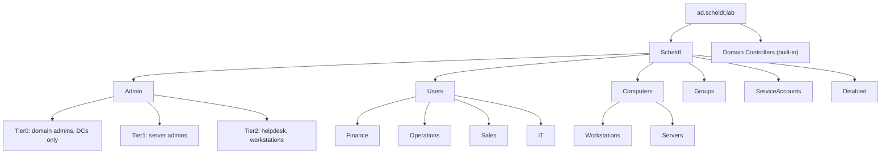
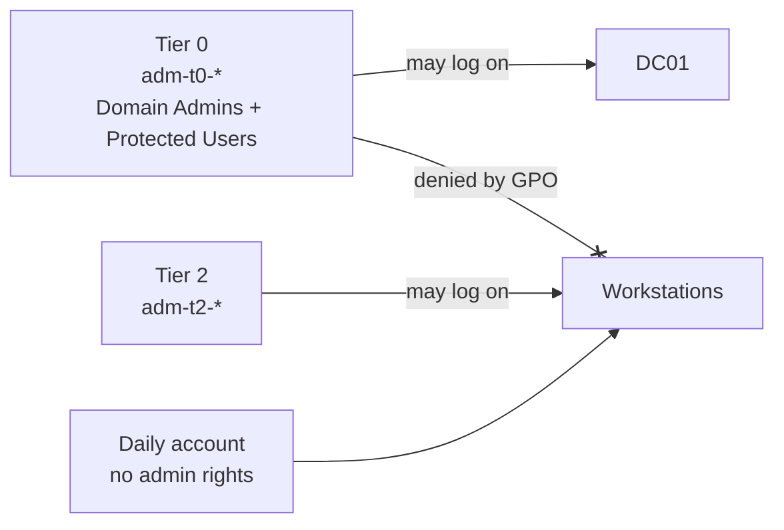

# Active Directory design

[Back to README](../README.md)

Domain `ad.scheldt.lab`, NetBIOS name `SCHELDT`. For a real client I would use a subdomain of a domain
they own, such as `ad.scheldtlogistics.be`. Never `.local`: it clashes with mDNS on Macs.

## OU structure

One top-level OU for the company keeps everything I create away from the built-in containers, so Group
Policy and delegation apply cleanly. Created by [06-New-OUStructure.ps1](../P1-active-directory/scripts/06-New-OUStructure.ps1).

New computers are redirected to `Workstations` with `redircmp`, so a fresh join gets the workstation
policies straight away instead of landing in the default `Computers` container where no GPO applies.

## Naming

| Object | Convention | Example |
|---|---|---|
| User | firstname.lastname + number | `lotte.peeters01` |
| Tier 0 admin | `adm-t0-<name>` | `adm-t0-rayan` |
| Tier 1 / Tier 2 admin | `adm-t1-<name>`, `adm-t2-<name>` | |
| Department group | `GG_<department>` (global) | `GG_Finance` |
| Resource group | `DL_<resource>_<RW or RO>` (domain local) | `DL_FinanceShare_RW` |
| Computer | `CL##`, `SRV##`, `DC##` | `CL01` |
| Security GPO | `SEC - <purpose>` | `SEC - LAPS` |

## Provisioning

[07-New-LabUsers.ps1](../P1-active-directory/scripts/07-New-LabUsers.ps1) creates 60 users the way an
HR export would arrive: random department, a random 18-character initial password, and "must change
password at next logon". The script writes a CSV with the initial passwords to the desktop for testing;
`.gitignore` blocks `*.csv` and the file is deleted after use.

## Admin tiering

Daily accounts have no admin rights. Tier 0 accounts are members of Protected Users, which turns off
NTLM, credential caching and delegation for them and limits Kerberos tickets to 4 hours. The GPO
`SEC - Deny Tier0 on workstations` stops a domain admin from ever typing their password on a machine
that a phishing mail could have compromised.
