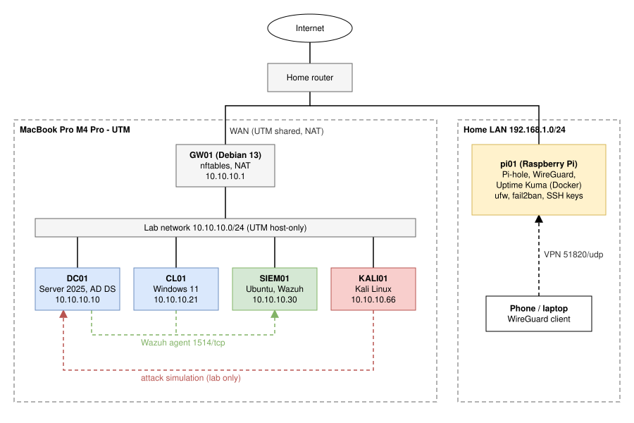
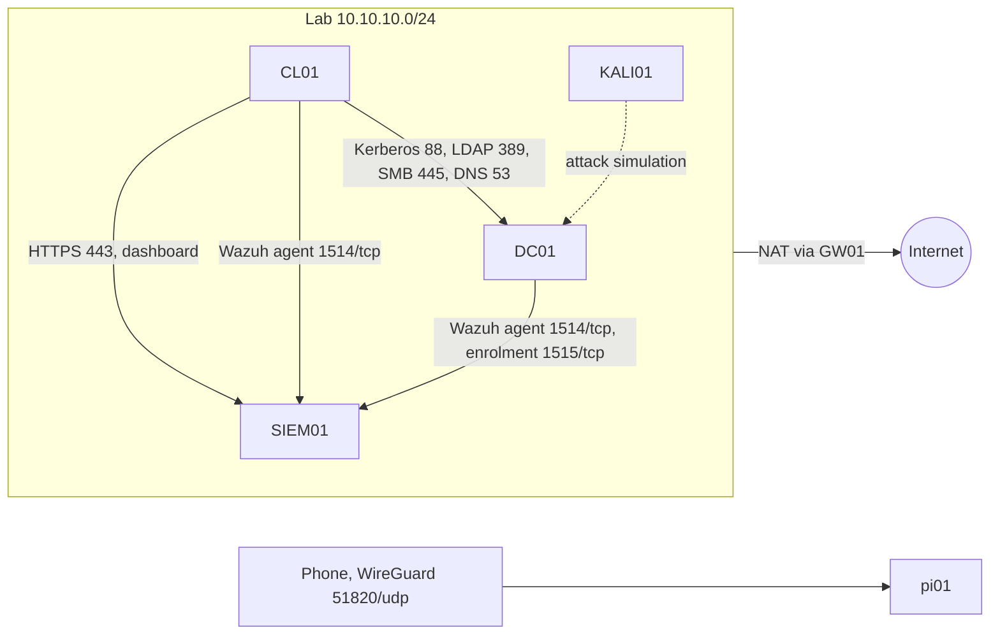

# Architecture and IP plan

[Back to README](../README.md)

Source: [architecture.drawio](images/architecture.drawio), open it in [draw.io](https://app.diagrams.net) to edit, then export as SVG over `architecture.svg`.

## Design goals

- **Everything on hardware I already own.** One MacBook Pro M4 Pro running UTM, one Raspberry Pi. No server, no paid cloud.
- **Isolated lab.** The Windows domain, SIEM and attacker sit on a UTM host-only network. They reach the internet only through GW01 and are not reachable from the home LAN.
- **Close to a real small company.** A router with a firewall, one domain controller, one workstation, central logging, and an edge box for DNS, VPN and monitoring.

## Networks

| Network | Subnet | Type | Who is on it |
|---|---|---|---|
| Home LAN | 192.168.1.0/24 (yours may differ) | physical | MacBook, pi01, home router |
| UTM shared network | assigned by UTM | NAT on the Mac | GW01 WAN interface only |
| Lab network | 10.10.10.0/24 | UTM host-only | GW01 LAN side, DC01, CL01, SIEM01, KALI01 |

## IP plan

| Host | IP | Gateway | DNS | vCPU / RAM / disk |
|---|---|---|---|---|
| GW01 | 10.10.10.1 (+ DHCP on shared NIC) | via shared NIC | 1.1.1.1 | 1 / 1 GB / 8 GB |
| DC01 | 10.10.10.10 | 10.10.10.1 | 127.0.0.1 | 2 / 3-4 GB / 64 GB |
| CL01 | 10.10.10.21 | 10.10.10.1 | 10.10.10.10 | 2 / 3-4 GB / 64 GB |
| SIEM01 | 10.10.10.30 | 10.10.10.1 | 10.10.10.10 | 4 / 6-8 GB / 60 GB |
| KALI01 | 10.10.10.66 | 10.10.10.1 | 10.10.10.10 | 2 / 2 GB / 30 GB |
| pi01 | fixed lease on home router, e.g. 192.168.1.50 | home router | itself (Pi-hole) | physical |

The lower RAM numbers fit a 24 GB MacBook with all VMs running. No DHCP server runs in the lab on purpose:
every host has a static address, which keeps the logs easy to read.

## Traffic flows

## GW01 firewall policy

The full ruleset is in [nftables.conf](../P1-active-directory/configs/gw01/nftables.conf).

| Chain | Policy | Allowed |
|---|---|---|
| input | drop | established/related, loopback, ping and SSH from the lab side |
| forward | drop | lab to WAN, plus return traffic |
| postrouting (nat) | n/a | masquerade on the WAN interface |

Nothing from the WAN side can open a connection into the lab.

## Choices and trade-offs

| Choice | Why | What I gave up |
|---|---|---|
| UTM with QEMU backend | Free, runs ARM64 Windows on Apple Silicon | Slower disk I/O than VMware Fusion |
| Debian + nftables instead of pfSense/OPNsense | pfSense has no ARM64 build for UTM; nftables is what many Linux firewalls use underneath | No web GUI |
| Windows Server 2025 ARM64 (Insider build via UUP dump) | Only way to run a native DC on Apple Silicon | Unsupported for production. Fallback: x64 VM in Azure for Students |
| Wazuh all-in-one on one VM | Open source, has Windows rules out of the box, used by real SOCs | Needs 6-8 GB RAM, the biggest VM in the lab |
| Pi on the home LAN, not in the lab | It is a physical box doing real work for my home network | It does not see lab traffic |
