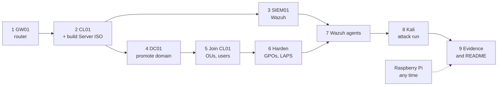

# Build guide

[Back to README](../README.md)

Order of work, with the script for each step. Planned as one long day if the ISO downloads are done the
evening before. Take a UTM snapshot (clone) after every step that works.



## Before you start

- UTM from [mac.getutm.app](https://mac.getutm.app), 150 GB free disk.
- ISOs: Windows 11 ARM64, Debian 13 arm64 netinst, Ubuntu Server 24.04 ARM64, Kali ARM64 installer.
- Raspberry Pi OS Lite 64-bit flashed with hostname `pi01` and your SSH public key.
- Every lab VM: **Virtualize**, QEMU backend, network **Host Only** with guest network `10.10.10.0/24`.
  GW01 gets a second NIC on **Shared Network** as its WAN.

Get the scripts into a Windows VM:

```powershell
Invoke-WebRequest https://github.com/rayaneljattari/enterprise-security-homelab/archive/refs/heads/main.zip -OutFile $env:TEMP\lab.zip
Expand-Archive $env:TEMP\lab.zip C:\Lab -Force
Set-ExecutionPolicy -Scope Process Bypass -Force
```

## Steps

| # | Host | Do | Done when |
|---|---|---|---|
| 1 | GW01 | Debian with SSH only, then `sudo bash setup-gw01.sh <WAN_IF> <LAN_IF>` | `nft list ruleset` shows the rules, 10.10.10.1 is up |
| 2 | CL01 | Windows 11, guest tools, `Rename-Computer CL01`, [01-Set-ClientNetwork.ps1](../P1-active-directory/scripts/01-Set-ClientNetwork.ps1). Build the Server ARM64 ISO with uupdump.net | `Test-NetConnection 1.1.1.1 -Port 443` is True |
| 3 | SIEM01 | Ubuntu, [01-netplan.yaml](../siem01/01-netplan.yaml) (DNS 1.1.1.1 until DC01 exists), [02-install-wazuh.sh](../siem01/02-install-wazuh.sh) | dashboard opens on https://10.10.10.30 |
| 4 | DC01 | Server Desktop Experience, `Rename-Computer DC01`, [02-Install-DC01.ps1](../P1-active-directory/scripts/02-Install-DC01.ps1), then [03-Configure-DNS.ps1](../P1-active-directory/scripts/03-Configure-DNS.ps1) | `dcdiag /test:dns` passes |
| 5 | CL01 | [04](../P1-active-directory/scripts/04-Join-CL01.ps1) join, [05](../P1-active-directory/scripts/05-Install-RSAT.ps1) RSAT, [06](../P1-active-directory/scripts/06-New-OUStructure.ps1) OUs, [07](../P1-active-directory/scripts/07-New-LabUsers.ps1) users, [08](../P1-active-directory/scripts/08-New-AdminAccount.ps1) admin | ADUC shows `Scheldt` with 60 users |
| 6 | DC01 / CL01 | PingCastle **before**, [09-Set-Hardening.ps1](../P1-active-directory/scripts/09-Set-Hardening.ps1), the four `SEC -` GPOs from [hardening.md](hardening.md), `gpupdate /force`, PingCastle **after** | `Get-LapsADPassword CL01` returns a password |
| 7 | DC01, CL01 | SIEM01 DNS to 10.10.10.10, then [Install-WazuhAgent.ps1](../windows-agents/Install-WazuhAgent.ps1) or the command from the dashboard | both agents active |
| 8 | KALI01 | IP 10.10.10.66, install netexec and kerbrute, run [attack-simulation.sh](../kali01/attack-simulation.sh) | spray visible in Wazuh |
| 9 | pi01 | [harden-pi.sh](../pi/harden-pi.sh), Docker, `.env`, `docker compose up -d` | 3 containers running, ufw active |
| 10 | all | [10-Test-Lab.ps1](../P1-active-directory/scripts/10-Test-Lab.ps1), fill [test-plan.md](test-plan.md), screenshots into [evidence](../evidence/) | README results filled in |

## Known risks on Apple Silicon

- **Windows Server ARM64** is an Insider build. If it will not install or promote, build DC01 as an x64
  VM in Azure for Students and keep everything else the same.
- **Wazuh agent on Windows ARM64** is not something I have verified yet. If it fails, I record it as a
  finding and try the newest agent release.

## Troubleshooting

| Symptom | Likely cause | Fix |
|---|---|---|
| Windows setup has no network | no virtio driver yet | `Shift+F10`, `OOBE\BYPASSNRO`, finish offline, install guest tools |
| VMs cannot reach each other | different host-only subnets | same guest network on every VM; test with `Test-NetConnection 10.10.10.10 -Port 389` |
| No internet in the lab | forwarding or NAT off | `sysctl net.ipv4.ip_forward`, `nft list ruleset`, gateway 10.10.10.1 |
| "Domain controller could not be contacted" | client DNS is not DC01 | DNS on clients must be only 10.10.10.10 |
| Kerberos or time errors | clock skew after a VM resume | `w32tm /resync` |
| GPO does not apply | wrong OU or not linked | `gpresult /h report.html` |
